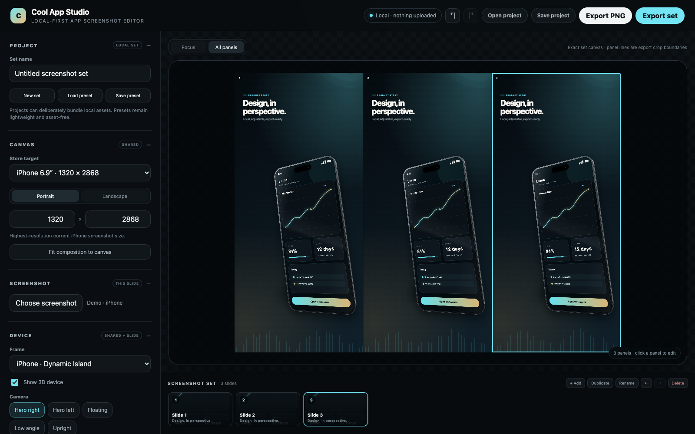
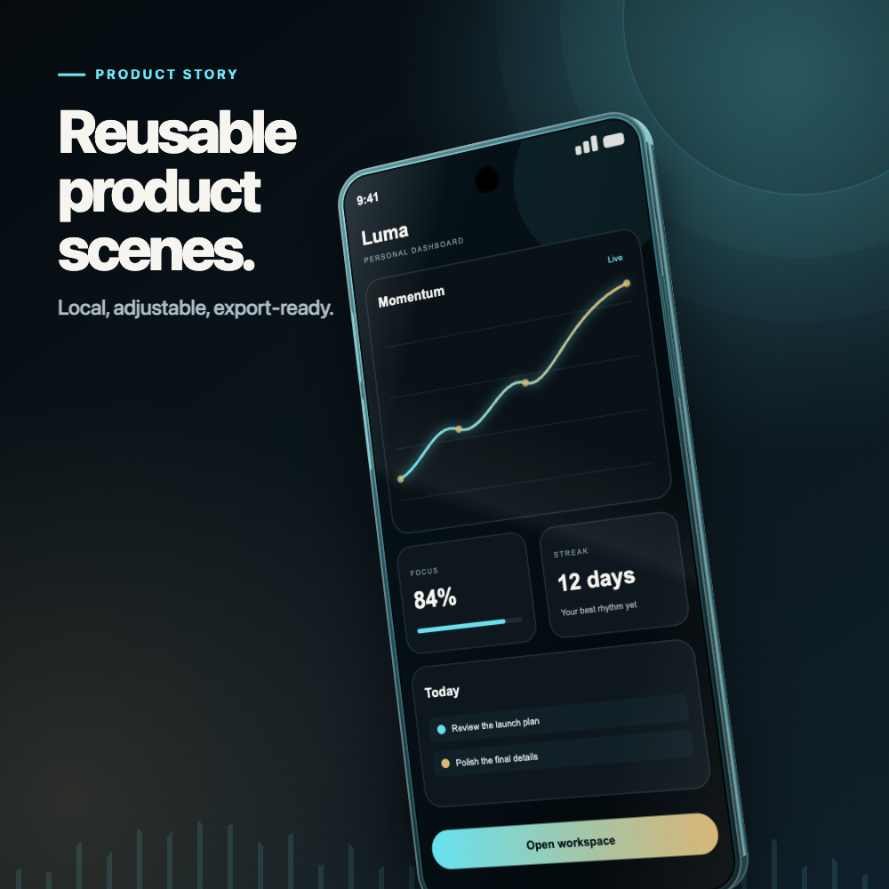

# Cool App Studio

Cool App Studio is a local-first editor for polished App Store and Google Play
screenshots. Drop in a capture, position an iPhone or Pixel-style device, set the
copy and art direction, then export deterministic PNGs without sending private
assets to a third-party service.

A Cool S Technologies project.

The project is preparing for a public `0.1.0` alpha. See the ordered
[product and distribution roadmap](ROADMAP.md), [privacy boundaries](PRIVACY.md),
and [contribution guide](CONTRIBUTING.md). Support expectations are documented
in [SUPPORT.md](SUPPORT.md).



[Watch the 15-second local multi-slide workflow](docs/workflow.webm).

<details>
<summary>Example exported composition</summary>



</details>

## Quick start

Requirements: Node.js 22 or newer and Chrome, Edge, Brave, or Chromium.

From a source checkout:

```sh
npm install
npm start
```

The editor opens at a printed `127.0.0.1` address and keeps all screenshots and
project assets on the local machine. Press `Ctrl+C` in the terminal to stop it.

After the public `0.1.0` package is available on npm, the equivalent one-off
command will be:

```sh
npx cool-app-studio
```

To start the packaged server without opening a browser, use
`npx cool-app-studio --no-open` and visit the printed address manually.

If rendering reports that no browser executable is available, install
Playwright's Chromium and launch the editor again:

```sh
npx playwright install chromium
```

Then rerun `npm start` from a source checkout or `npx cool-app-studio`
after package publication.

If you installed a persistent global command instead of using `npx`, remove it
with `npm uninstall --global cool-app-studio`. The project does not install
a background service or retain screenshots outside files you explicitly save.

## Interactive workflow

1. Choose a PNG, JPEG, WebP, or SVG screenshot.
2. Select an App Store, Google Play, or custom canvas.
3. Set the shared device, background, font, colors, and type styling.
4. Adjust the current slide's copy, screenshot, device position, and copy position.
5. Add, duplicate, rename, and reorder slides in the screenshot-set strip.
6. Choose **Export PNG** for the current slide or **Export set** for an ordered
   ZIP containing every full-resolution PNG.

Shared controls are labeled in the editor and update the full set. Slide-level
controls let each composition carry its own story and framing without drifting
away from the set's brand treatment. A set can contain up to ten slides.

Use **All panels** to fit the complete set into one continuous editor view. The
panel lines are the exact crop boundaries used during export, and clicking a
panel selects it for focused editing.

## Continuous elements across panels

**Across panels** can turn the current 3D device into one set-level element that
crosses two to five adjacent panels. Choose the range and screenshot source,
then adjust the device's horizontal position, vertical position, and scale. Its
3D angle can be copied from any selected slide.

The device is rendered once across a continuous canvas—not independently on
each slide—so its perspective and edges line up exactly at panel boundaries.
Individual PNG export and batch ZIP export both use the same crop pipeline.

The canvas menu includes current mobile store targets:

- App Store iPhone 6.9-inch: 1320 × 2868
- App Store iPad 13-inch: 2064 × 2752
- Google Play phone: 1080 × 1920
- Google Play feature graphic: 1024 × 500

Portrait-capable targets can be switched to landscape. **Fit composition to
canvas** provides a useful starting layout after a major aspect-ratio change,
without changing the copy or palette. Store requirements were last verified on
2026-07-14 against the official
[Apple](https://developer.apple.com/help/app-store-connect/reference/app-information/screenshot-specifications)
and [Google Play](https://support.google.com/googleplay/android-developer/answer/9866151)
documentation.

## Local backgrounds and fonts

Backgrounds can use a built-in treatment, solid color, gradient, transparent
canvas, or local image. Local images support cover/contain fitting, focal
position, zoom, blur, and a readability overlay. Typography includes offline
font stacks plus local WOFF2, WOFF, TTF, and OTF files.

Selected screenshots, backgrounds, and font files stay in memory and are sent
only to the renderer bound to `127.0.0.1`. **Save preset** retains styling and
filename hints without asset bytes. **Save project** deliberately creates a
portable `.cool-app-studio` JSON bundle containing only the local assets currently
used by the set, so it can be reopened without reselecting them. Projects saved
as `.screenshot-forge` or `.mockup-studio` remain importable.

The editor remembers project metadata in local browser storage but does not
persist asset bytes there. After a browser restart, reopen the project bundle or
reselect local assets. Preset JSON files can also be loaded into a later session
or used by the CLI.

## Set editing shortcuts

- `Cmd/Ctrl + Z` — undo
- `Shift + Cmd/Ctrl + Z` or `Ctrl + Y` — redo
- `Cmd/Ctrl + D` — duplicate the selected slide
- `Alt + Left/Right` — reorder the selected slide
- `Cmd/Ctrl + S` — save the portable project bundle

## Deterministic CLI renders

```sh
node src/cli.mjs render \
  --input examples/sample-pixel.svg \
  --output output/editorial.png \
  --config examples/editorial-preset.json
```

Flags override values from the preset:

```sh
node src/cli.mjs render \
  --input path/to/screenshot.png \
  --output output/hero.png \
  --device pixel \
  --preset floating \
  --shell gold \
  --background aurora \
  --width 1200 \
  --height 2400 \
  --kicker "ROOM-AWARE AUDIO" \
  --headline "Quiet, shaped live." \
  --subhead "Continuous masking on your device."
```

Store targets and local assets are also available from the CLI:

```sh
node src/cli.mjs render \
  --input path/to/screenshot.png \
  --output output/play-feature.png \
  --canvas google-feature \
  --backgroundImage path/to/background.jpg \
  --fontFile path/to/brand-font.woff2 \
  --headline "A clearer daily rhythm."
```

Run `node src/cli.mjs help` for the complete option list. Output dimensions can
range from 320 to 4096 pixels per side. `--transparent` creates a reusable
device-only layer, and `--noDevice` creates a text-led composition.

## Browser and privacy behavior

- The HTTP server listens only on `127.0.0.1`.
- Unexpected loopback hosts, cross-origin browser API requests, and non-JSON API
  requests are rejected.
- Sensitive render API requests also require a per-process capability token held
  only by the local editor and renderer pages; it is not an account credential.
- Screenshot, background, and font data is read into memory for preview and
  rendering; it is not written by the server or uploaded.
- Export jobs are removed from memory when the render finishes.
- `CHROME_PATH` can point to a specific Chromium-family browser.

Portable project bundles deliberately contain the local assets used by the
project. Treat them as sensitive if the screenshots, fonts, logos, or backgrounds
are confidential. See [PRIVACY.md](PRIVACY.md) for the complete boundary.

## Verification

```sh
npm test
```

The verification suite checks preset and project migration, asset-bundle
behavior, deterministic ZIP creation, continuous multi-panel crops, and real
browser renders at every store target. Each PNG's signature and dimensions are
validated.

## Repository layout

- `src/cli.mjs` — local server, batch endpoint, and deterministic render CLI
- `src/studio/` — interactive set editor, project model, and scene renderer
- `src/zip.mjs` — dependency-free deterministic ZIP writer
- `examples/` — generic screenshots and a reusable preset
- `test/` — model, archive, continuous-crop, and end-to-end render checks

## Open source

Cool App Studio is licensed under [Apache-2.0](LICENSE). Please read
[CONTRIBUTING.md](CONTRIBUTING.md) before proposing a change and use the private
process in [SECURITY.md](SECURITY.md) for security or privacy reports.
Bundled and historical media provenance is recorded in
[docs/ASSET_PROVENANCE.md](docs/ASSET_PROVENANCE.md).
